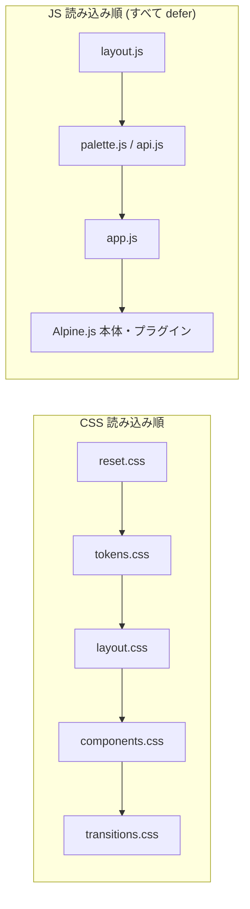
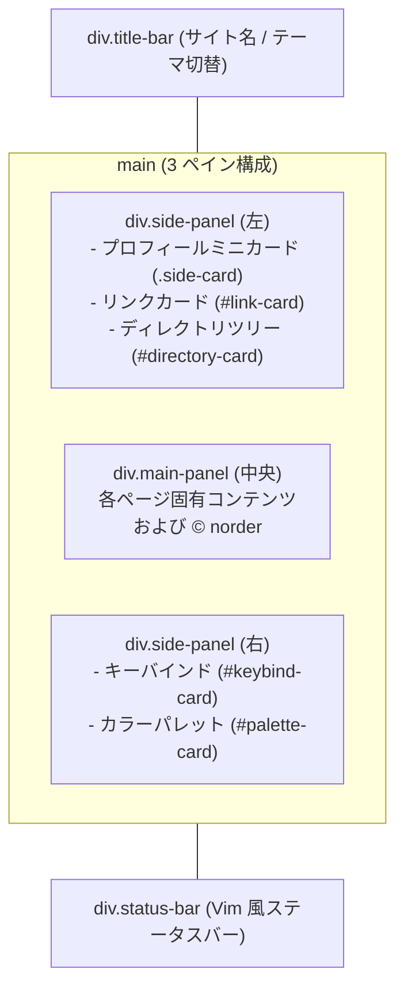

# norder's portfolio 仕様書 / Specification for norder's portfolio

初回更新日: 2026/11/22(日)  
最終更新日: 2026/11/22(日)  
作成者: norder  

`#ポートフォリオ` `#仕様書` `#設計` `#Web開発`  
`#portfolio` `#specification` `#design` `#web`


## 1. 概要

本資料は, 個人ポートフォリオサイト `norder's portfolio` の設計仕様および実装手順を定めるものです.  
本資料を参照することで, 画面構成, ファイル責務, 機能仕様, および実装ステップを一貫した設計思想のもとで再現・保守できる状態を目指します.

### 1.1. コンセプトと設計方針

- ビルドツールや外部 CSS フレームワークに依存せず, ブラウザ標準機能と最小限の軽量ライブラリで動作する静的サイトを構築します.
- TUI を意識した 3 ペイン構成と Nord Theme を基調とし, キーボード操作や Vim 風のステータスバーを備えます.
- HTML, CSS, JavaScript の各ファイルを責務単位で分離し, 変更の影響範囲を局所化する疎結合な構造を維持します.


## 2. 技術スタックと開発環境

### 2.1. 使用技術一覧

| 技術・ツール | 担当する役割 | 実現する機能・目的 |
| :--- | :--- | :--- |
| HTML | ページの骨組み | ビルドツールなしでブラウザ上にて直接動作する静的構造 |
| 自作 CSS | 見た目・単体の動き | 独自レイアウト, CSS 変数による配色管理, ホバー等のアニメーション |
| Web Components | 共通外枠の分離 | `<portfolio-layout>` によるヘッダ・左右サイドバー・ステータスバーの共通化 |
| Alpine.js | 画面内の状態管理 | 開閉・検索・ページネーション等の状態保持, `x-transition` による表示演出 |
| Alpine.js (Persist) | 状態のブラウザ保存 | テーマカラーやカード開閉状態をリロード・ページ遷移後も維持 |
| Alpine.js (Collapse) | 高さ可変の開閉 | サイドバー内カードの中身に応じた滑らかなアコーディオン開閉 |
| View Transitions API | 画面全体の変化演出 | ページ移動時の遷移演出, およびテーマ切替時に色が広がる演出 |
| Lucide / Simple Icons | アイコン・ロゴ素材 | UI アイコンおよび技術・SNS ロゴの表示 (SVG による柔軟な色・サイズ制御) |
| GitHub Pages | 公開サーバー | Git への push による無料公開および自動更新 |

### 2.2. 動作・公開環境

- **ホスティング:** GitHub Pages (サブディレクトリ `/portfolio/` 配下での公開を想定)
- **パス解決方針:** ローカル環境および GitHub Pages の双方で動作するよう, 静的アセットおよびページ間リンクは `./` から始まる相対パスで統一します.

> [!NOTE]
> `Alpine.js` やアイコン素材の具体的なバージョンおよび読み込み方法 (CDN 参照またはローカル同梱) は現時点で未確定です. 確定次第, 本節に追記します.


## 3. ファイル構成と責務分離

### 3.1. ディレクトリ構成

```text
portfolio/
├── index.html              # home ページ
├── profile.html            # profile ページ
├── products.html           # products ページ
├── articles.html           # articles ページ
├── css/
│   ├── reset.css           # ブラウザ標準スタイルの初期化
│   ├── tokens.css          # Nord Theme のカラー・デザイン数値の CSS 変数定義
│   ├── layout.css          # ヘッダ・3 ペイン・ステータスバーの全体骨格とスクロール制御
│   ├── components.css      # カード・線区切りリスト・検索バー・ページネーション等の部品
│   └── transitions.css     # View Transitions やヘッダ開閉等のアニメーション演出
└── js/
    ├── layout.js           # <portfolio-layout> の DOM 展開と現在地ハイライト
    ├── palette.js          # Nord 全 16 色のデータ定義とクリップボードコピー処理
    ├── api.js              # GitHub / Qiita API の非同期取得とキャッシュ制御
    └── app.js              # Alpine.js による全体状態管理・キーバインド・ステータスバー制御
```

### 3.2. HTML の責務と読み込み順

4 つの HTML ファイルは, 共通の外枠を `<portfolio-layout>` タグへ委譲し, 各ページ固有のコンテンツのみをタグ内部に記述します.

#### 3.2.1. `<head>` 内の読み込み順序

CSS は基本設定から個別演出へ向かって上書きされる順序とし, JavaScript はすべて `defer` 属性を付与して DOM 展開から状態初期化の順序を保証します.



> [!TIP]
> `profile.html` は外部 API 通信を行わないため, `api.js` を読み込まない静的ページとして独立させることができます.

### 3.3. CSS の責務境界

- `reset.css`: `box-sizing` やデフォルトの余白初期化など, 配色や配置に依存しない無色透明なリセットのみを記述します.
- `layout.css`: `title-bar`, 3 カラム (`side-panel` / `main-panel` / `side-panel`), `status-bar` の配置, 独立スクロール, 画面幅に応じたレイアウト調整を担当します.
- `components.css`: `side-card`, 線区切りリスト, 検索バー, ページネーション, パレット等の単体パーツの装飾を担当します. 外側の配置や幅への依存は持たせません.
- `transitions.css`: `@view-transition`, テーマ切替時の演出, スクロール連動のヘッダ表示切替, ホバー時のトランジション時間を集約します.

### 3.4. JavaScript の責務境界

- `layout.js`: Shadow DOM を使用しない Light DOM の Custom Element として `<portfolio-layout>` を定義します. 内部の HTML を退避したうえで共通外枠を展開し, 中央の `main-panel` へ戻します. また, `location.pathname` から左サイドバーの現在地を自動判定します.
- `palette.js`: Nord Theme 全 16 色の名称・カラーコード配列と, クリップボードへのコピー処理を提供します.
- `api.js`: GitHub API および Qiita API からのデータ取得, ブラウザへのキャッシュ保存・有効期限判定, 検索およびページネーション向けのデータ整形を担当します.
- `app.js`: Alpine.js の状態・ストア登録を行い, テーマ切替, カード開閉, スクロール監視, キーボードショートカット, ステータスバー表示更新を統括します.


## 4. 画面・UI 設計

### 4.1. 共通フレームと DOM クラス設計

画面全体は上下のバーと中央 3 ペインで構成します.



#### 4.1.1. ヘッダ (`div.title-bar`)

- 左端にサイト名 (`norder's portfolio`), 右端にテーマ切替ボタンを配置します.
- 中央パネル (`main-panel`) を下方向へスクロールするとヘッダが隠れ, 上方向へスクロールすると再表示される挙動とします.

#### 4.1.2. 左サイドパネル (`div.side-panel`)

各ブロックは共通クラス `side-card` を付与します.

- **プロフィールミニカード**: GitHub から取得したアイコンと `norder` の名前のみを表示します.
- **リンクカード (`#link-card`)**: GitHub および Qiita への外部リンクを配置します.
- **サイト構成カード (`#directory-card`)**: `/home ~` 配下に `profile`, `products`, `articles` へのリンクをツリー表示します. 現在閲覧中のページを視覚的に強調し, `Collapse` により開閉可能とします.

#### 4.1.3. 右サイドパネル (`div.side-panel`)

各ブロックは共通クラス `side-card` を付与します.

- **キーバインドカード (`#keybind-card`)**: サイト内で有効なショートカットキー一覧を表示します. `Collapse` により開閉可能とします.
- **カラーパレットカード (`#palette-card`)**: Nord Theme のカラーパレットを表示し, クリックでカラーコードをコピー可能とします. `Collapse` により開閉可能とします.

#### 4.1.4. ステータスバー (`div.status-bar`)

- 画面最下部に固定配置し, Vim 風のモード表示 (例: `normal >~`) や操作状況・現在ページに応じた情報を表示します.

### 4.2. カラーテーマと画面遷移演出

- 選択されたテーマは `Persist` によりブラウザへ保存し, リロードや別ページ移動後も維持します.
- テーマ切替時は `document.startViewTransition()` を用いて画面全体へ色が広がる演出を行います.
- ページ間移動時は CSS の `@view-transition { navigation: auto; }` により滑らかな画面遷移を行います.

### 4.3. ページ別構成 (`div.main-panel` 内部)

| ページ | ファイル | 主な表示要素 |
| :--- | :--- | :--- |
| home | `index.html` | 挨拶 (`welcome to norder's portfolio`), 簡単な自己紹介, 各ページ (`profile` / `products` / `articles`) への誘導カード, 最新の `products` 約 2 件, 最新の `articles` 約 2 件, `© norder` |
| profile | `profile.html` | 詳細プロフィールカード (アイコン・`norder`・簡易紹介・リンク), 各セクション (`about me` / `design stance` / `language roles` / `vision` / `meta data`), `© norder` |
| products | `products.html` | 検索バー, GitHub リポジトリ一覧 (カード形式ではなく横線区切り, 1 ページ 8 件, タイトル・概要・言語表示), 左右ページ移動 (`< 1 / 3 >`), `© norder` |
| articles | `articles.html` | 検索バー, Qiita 記事一覧 (カード形式ではなく横線区切り, 1 ページ 8 件, タイトル・タグ・日付 `yyyy/mm/dd` 表示), 左右ページ移動 (`< 1 / 3 >`), `© norder` |


## 5. 機能・データ仕様

### 5.1. 外部 API 連携とキャッシュ制御

- **GitHub API**: プロフィールアイコンおよびリポジトリ一覧 (`products`) を自動取得します.
- **Qiita API**: 公開記事一覧 (`articles`) を自動取得します.
- **ブラウザキャッシュ**: 取得した記事データ等は `localStorage` 等のブラウザストレージにキャッシュし, 不要な再通信とレート制限到達を防止します. 取得失敗時はエラー表示または予備アイコン (`assets/fallback-avatar.svg`) へフォールバックします.

> [!WARNING]
> GitHub REST API の未認証リクエストには 1 時間あたり 60 回の上限があるため, Qiita 記事だけでなく GitHub 側の取得結果にもキャッシュを適用することが推奨されます [未検証: 実運用時の呼び出し頻度に応じた最終調整が必要です].

### 5.2. 検索およびページネーション

- `products` および `articles` の各ページにおいて, キーワードによるリアルタイム検索を提供します.
- 表示件数は 1 ページあたり最大 8 件に制限します.
- 左右ボタンによるページ送り, および現在ページ / 総ページ数 (`< 1 / 3 >`) の表示を行います. 検索条件が変化した場合は 1 ページ目へ自動的にリセットします.

### 5.3. キーボード操作とステータスバー連動

- `#keybind-card` に記載されたキーバインドにより, ページ遷移, ページネーション移動, 検索入力へのフォーカス等の操作を実行可能とします.
- 検索バー等の入力要素にフォーカスしている間は, 単一キーによるショートカットが誤爆しないよう入力中判定を行います.
- 現在のフォーカス状態や実行した操作に合わせて, `div.status-bar` の表示内容を動的に更新します.


## 6. 実装手順

手戻りを抑えるため, 共通骨格とテーマを先に完成させ, 静的ページ, 動的データ, キー操作の順で段階的に実装します.

### 6.1. ステップ 1: CSS 変数と共通レイアウト骨格の作成

- **操作:** `reset.css`, `tokens.css`, `layout.css`, `layout.js` を作成し, `index.html` から読み込んで `<portfolio-layout>` の 3 ペイン構成を組みます.
- **結果:** ヘッダ, 左右サイドパネル, 中央パネル, ステータスバーが表示され, 中央パネルのみが独立してスクロールできる骨格が完成します.
- **確認:** `location.pathname` に応じて左サイドバーの現在地ハイライトが付与されること, および HTML の重複記述がないことを確認します.

### 6.2. ステップ 2: テーマ切替・遷移演出と UI ギミックの実装

- **操作:** `palette.js`, `app.js`, `transitions.css` を作成し, `@view-transition`, サイドカードの `Collapse` 開閉, パレットのクリックコピー, 中央パネルのスクロール連動ヘッダ制御を実装します.
- **結果:** 見た目と基本インタラクションが全ページ共通で動作する状態になります.
- **確認:** リロード後もテーマと開閉状態が保持されること, パレットクリックで正しいカラーコードがコピーされること, 下スクロールでヘッダが隠れることを確認します.

### 6.3. ステップ 3: 静的ページ (`home` / `profile`) の実装

- **操作:** `components.css` に基本パーツのスタイルを記述し, `index.html` と `profile.html` の `<portfolio-layout>` 内部をマークアップします.
- **結果:** 自己紹介および 5 セクション構成の `profile` ページと, `home` の静的セクションが完成します.
- **確認:** `index.html` と `profile.html` の間をリンク移動した際に `@view-transition` による遷移演出が効き, 左サイドバーの現在地表示が切り替わることを確認します.

### 6.4. ステップ 4: API 連携・キャッシュ・一覧機能の実装

- **操作:** `api.js` に GitHub / Qiita API の取得・キャッシュ・絞り込み・ページ分割処理を実装し, `products.html`, `articles.html`, および `index.html` の最新 2 件表示へ接続します.
- **結果:** 外部サービスから最新データが自動取得され, 1 ページ 8 件の線区切りリストと検索機能が動作します.
- **確認:** 2 回目以降の読み込みでキャッシュが利用されること, 検索後にページネーション件数が正しく再計算されること, 通信遮断時にも画面が崩れないことを確認します.

### 6.5. ステップ 5: キーボード操作とステータスバー連動の実装

- **操作:** `app.js` にキーイベントリスナーを追加し, `#keybind-card` の内容と実際のショートカット処理, および `status-bar` の表示更新を連動させます.
- **結果:** マウスを使わずに主要ページ移動や一覧操作が完結する TUI 風の操作体験が完成します.
- **確認:** すべての記載キーバインドが意図通り動作すること, および検索欄入力中にショートカットが誤作動しないことを確認します.


## 7. 未確定事項・注意事項

### 7.1. 要決定事項 (`[未確定]`)

実装着手前, または該当ステップの実装時に以下の詳細を決定する必要があります.

- **キーバインドの具体的な割り当て:** ページ遷移 (例: `1`〜`4` や `g h` 等), ページ送り (`h` / `l` 等), 検索フォーカス (`/`), テーマ切替等のキー定義.
- **キャッシュの有効期限 (TTL) と対象範囲:** キャッシュ保持時間 (例: 1 時間, 24 時間等), および GitHub リポジトリ・アイコンへのキャッシュ適用有無.
- **API 取得の絞り込み条件:** 取得対象ユーザー名 (`norder-lab` 等), フォーク済みリポジトリやアーカイブ済みリポジトリの除外有無, 並び順 (更新日順・スター数順等).
- **レスポンシブ設計:** タブレット・スマートフォン幅における左右 `side-panel` の非表示・ドロワー化等の挙動.
- **アイコンおよび Alpine.js の読み込み方式:** CDN 経由かローカルファイル同梱かの選定.

### 7.2. 技術的な注意事項

- **View Transitions API のブラウザ対応:** MPA 向けの `@view-transition { navigation: auto; }` および `document.startViewTransition()` は, 一部ブラウザや旧バージョンで未対応の可能性があります [未検証]. `if (document.startViewTransition)` による存在チェックを行い, 未対応環境では通常の即時切替へフォールバックさせる設計とします.
- **Light DOM と Alpine.js の初期化順序:** `<portfolio-layout>` の展開前に Alpine.js が起動すると外枠内のディレクティブが評価されない可能性があります. `layout.js` は必ず Alpine.js 本体より前に記述し, `defer` 属性で実行順を固定します.
- **個人情報および認証情報の扱い:** 静的サイトのため, クライアント側の JavaScript に API トークンや個人を特定する秘匿情報を埋め込まないよう徹底します.
