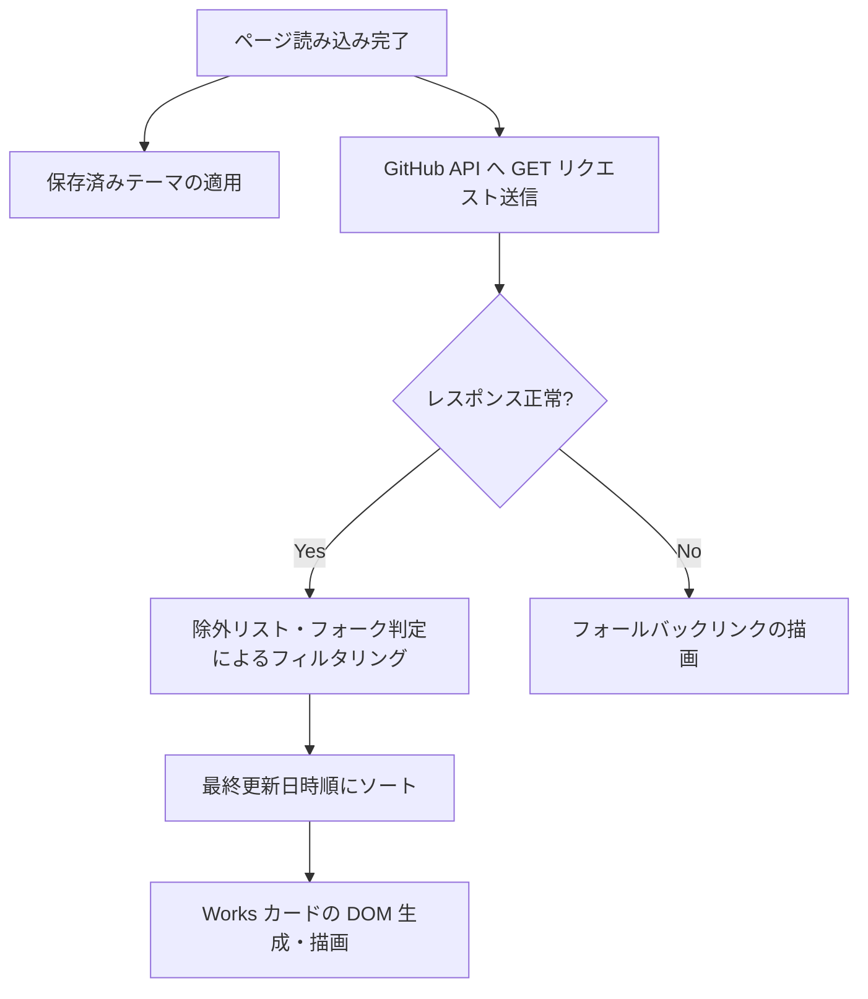

# ポートフォリオサイト仕様書 / Portfolio Website Specification  

初回更新日: 2026/11/14(土)  
最終更新日: 2026/11/14(土)  
作成者: norder  


## 1. 概要  

本資料は, `GitHub Pages` 上で公開する個人ポートフォリオサイト(`https://norder-lab.github.io/`)の要件および技術仕様を定義するものです.  
ビルドツールや外部ライブラリに依存しない素の Web 標準技術のみで構成し, 設計思想や技術スタック, `GitHub` 上の公開リポジトリを自動描画するシングルページサイトの設計基準を定めます.  


## 2. 目的  

本サイトの構築および仕様策定の目的は, 以下の 3 点です.  

- **情報集約:** 自身のプロフィール, 設計思想, 開発環境, および制作物を 1 ページに集約し, 個人開発の拠点とすること.  
- **実績アピール:** 就職活動において, 技術的なこだわりや設計力の背景, ならびに実際の成果物を採用担当者やエンジニアへ明確に提示すること.  
- **保守性の確保:** 特定のフレームワークやビルド環境に依存しない疎結合な構成を採用し, 長期間にわたり低コストで運用・更新できる状態を維持すること.  


## 3. 前提条件および開発環境  

### 3.1. 公開環境  

本サイトは `GitHub Pages` のユーザーサイト機能を利用してホスティングします.  

| 項目                 | 設定値                              |  
|:--------------------:|:------------------------------------|  
| GitHub アカウント ID | `norder-lab`                        |  
| リポジトリ名         | `norder-lab.github.io`              |  
| 公開範囲             | `Public`                            |  
| 公開 URL             | `https://norder-lab.github.io/`     |  
| デプロイ対象ブランチ | `main` ブランチ(ルートディレクトリ) |  

### 3.2. 技術スタック  

外部パッケージやトランスパイラを一切使用せず, ブラウザ標準機能のみで動作する構成とします.  

- **マークアップ:** `HTML5`(セマンティックタグを使用)  
- **スタイリング:** `CSS3` (CSS Variables, Flexbox, CSS Grid を使用)  
- **ロジック:** `Vanilla JS` (`ES2020` 以降の標準構文, `Fetch API` を使用)  
- **外部 API:** `GitHub REST API v3`  

### 3.3. ファイル構成  

保守性と役割分離を意識し, 以下の最小限のディレクトリ構成を採用します.  

```text
norder-lab.github.io/
├── index.html      # 画面構造および静的プロフィールコンテンツ
├── style.css       # Nord カラー定義, レイアウト, レスポンシブスタイル
└── script.js       # テーマ切替制御および GitHub API からの Works 自動描画
```


## 4. デザインおよび操作性仕様  

### 4.1. カラーテーマ設計(Nord Theme)  

全体の配色は `Nord Theme` を基調とし, OS の外観設定(prefers-color-scheme)への自動連動と, 画面上のボタンによる手動切替の両方に対応します.  
手動で選択したテーマ設定は `localStorage` に保存し, 次回アクセス時にも維持します.  

| 役割                 | CSS変数名        | Dark Theme(Nord Dark)    | Light Theme(Nord Light)    |  
|:--------------------:|:----------------:|:-------------------------|:---------------------------|  
| 背景色(ベース)       | `--bg-primary`   | `#2E3440`                | `#ECEFF4`                  |  
| 背景色(カード・面)   | `--bg-surface`   | `#3B4252`                | `#E5E9F0`                  |  
| 境界線               | `--border-color` | `#434C5E`                | `#D8DEE9`                  |  
| 補助テキスト         | `--text-muted`   | `#81A1C1`                | `#4C566A`                  |  
| 本文テキスト         | `--text-primary` | `#D8DEE9`                | `#2E3440`                  |  
| 強調テキスト・見出し | `--text-bright`  | `#ECEFF4`                | `#2E3440`                  |  
| アクセントカラー 1   | `--accent-cyan`  | `#88C0D0`                | `#5E81AC`                  |  
| アクセントカラー 2   | `--accent-blue`  | `#81A1C1`                | `#81A1C1`                  |  

### 4.2. タイポグラフィおよびレスポンシブ対応  

- **フォント指定:** 外部 Web フォントの読み込みによる描画遅延を防ぐため, OS 標準の等幅フォントファミリー(`ui-monospace, SFMono-Regular, Menlo, Monaco, Consolas, monospace`)を基本として指定します.  
- **コンテンツ幅:** PC 閲覧時の可読性を高めるため, メインコンテナの最大幅を `800px` 程度に設定し, 中央配置とします.  
- **ブレイクポイント:** 画面幅 `640px` 以下をモバイル表示の基準とし, グリッドの 1 カラム化や余白の最適化を行います.  

### 4.3. キーボード操作およびアクセシビリティ  

> [!IMPORTANT]  
> 本サイトでは, JavaScript による独自の `Vim` キーバインド(`j` / `k` スクロール等)は実装しません.  

ブラウザ拡張機能(`Vimium` 等)やブラウザ標準のキーボードナビゲーションとのキー競合を回避するため, 独自キーイベントのフックは行わず, 標準的なリンクフォーカス(`Tab` キー移動)およびセマンティック HTML によるアクセシビリティ確保に徹します.  


## 5. 画面構成およびコンテンツ仕様  

### 5.1. 全体レイアウト  

情報は 1 ページ完結の縦スクロール形式で配置し, `Header` , `About & Skills` , `Works` の 3 セクションで構成します.  
なお, 記事一覧(`Articles`)およびお問い合わせフォーム(`Contact`)は本サイトには設けません.  

### 5.2. Header セクション  

ページの最上部に配置し, ファーストビューで人物像と主要リンクを把握できる構成とします.  

- **アイコン画像:** `https://github.com/norder-lab.png` を参照し, 円形または角丸で表示します.  
- **名前:** `norder`  
- **肩書:** 情報系 / データサイエンス専攻の大学生  
- **外部リンク:**  
  - `GitHub`: `https://github.com/norder-lab`  
  - `Qiita`: `https://qiita.com/norder`  
- **テーマ切替 UI:** ダークテーマとライトテーマを即座に切り替えられるトグルボタンを配置します.  

### 5.3. About & Skills セクション  

就職活動におけるアピール要素として, 技術選定の理由や開発スタンスを明確に言語化して掲載します.  

1. **設計思想および技術スタンス:**  
   - 特定の OS やマシンスペックに依存しない「疎結合でシンプルな設計」の重視.  
   - キーボード完結の操作感と軽量・高速な動作へのこだわり, および TUI ツールにおける `Vim` キーバインドの標準実装.  
2. **言語ごとの役割と今後の展望:**  
   - `Java`: 2019 年に最初期に触れた言語であり, 厳格なオブジェクト指向を通じて設計思想の基礎を培った基盤.  
   - `Rust`: メモリ安全性と高速性が求められる, 信頼性の高い TUI / CLI ツール開発の主軸.  
   - `Python`: データ分析, 機械学習, および豊富なエコシステムを活用したプロトタイピングの主軸.  
   - **展望:** 機械学習モデルと実用的なプロダクトを掛け合わせたツール開発, および技術領域の変化に好奇心を持って柔軟に適応する姿勢.  
3. **座右の銘(Motto):**  
   - 終わりよければ全て良し  
   - 遠回りくらいが丁度いい  
   - 必要性は発明の母  
4. **興味分野・趣味(Interests):**  
   - 技術 / 数学 / 心理学 / ミステリ小説  
5. **開発環境(Environment):**  
   - `WezTerm` / `Neovim` / `Yazi` / `StartuiLauncher`  
6. **使用言語(Tech Stack):**  
   - **Main:** `Rust` , `Python` , `Java`  
   - **Other:** `JavaScript` , `HTML` , `CSS` , `SQL` , `R` , `C`  

### 5.4. Works セクション  

`GitHub` 上の公開リポジトリをカード形式のグリッドレイアウトで一覧表示します.  
各カードには以下の要素を含めます.  

- リポジトリ名(リポジトリページへのリンク)  
- 概要説明文(`description`)  
- 主要プログラミング言語(`language`)  
- トピックタグ(`topics` が設定されている場合)  
- デモ / 公開ページリンク(`homepage` が設定されている場合)  


## 6. 動的描画および API 連携仕様  

### 6.1. 処理フロー  

ページ読み込み完了時(`DOMContentLoaded`)に, テーマ初期化および `GitHub REST API` からのリポジトリ取得を非同期で実行します.  



### 6.2. GitHub REST API 仕様  

クライアントサイドの `JavaScript` から認証不要の公開エンドポイントを呼び出します.  

- **エンドポイント:** `https://api.github.com/users/norder-lab/repos?per_page=100&sort=updated`  
- **HTTP メソッド:** `GET`  
- **リクエストヘッダ:** `Accept: application/vnd.github.v3+json`  

### 6.3. フィルタリングおよびソート仕様  

取得したリポジトリ配列に対し, 表示対象を絞り込むためのフィルタリングを適用します.  

- **除外リストによる非表示(ブラックリスト方式):**  
  プロフィール用リポジトリや本サイト自身など, 制作物として表示しないリポジトリ名を配列で定義し除外します.  
  ```javascript
  const EXCLUDED_REPOS = [
    "norder-lab",
    "norder-lab.github.io"
  ];
  ```
- **フォークリポジトリの扱い:**  
  原則として自身の制作物をアピールするため, `repo.fork === true` のリポジトリは表示対象から除外します.  
- **ソート順:**  
  リポジトリの最終プッシュ日時(`pushed_at`) の降順で並べ替え, 直近で開発・更新している実績が上位に表示されるようにします.  

### 6.4. エラーハンドリングおよびフォールバック  

未認証での `GitHub REST API` 呼び出しは, 同一 IP アドレスあたり 1 時間につき 60 回までのレート制限があります.  
制限超過(`HTTP 403`)やネットワーク障害が発生した場合は, ローディング表示を消去し, `https://github.com/norder-lab?tab=repositories` へ直接誘導するフォールバックメッセージを表示します.  


## 7. 非機能要件および運用ルール  

### 7.1. パフォーマンス  

- 外部 CSS フレームワークや JavaScript ライブラリを読み込まないことで, 初期転送量を最小限に抑えます.  
- レンダリングブロックを防ぐため, `<script src="script.js" defer></script>` を使用します.  

### 7.2. デプロイおよび更新運用  

- ソースコードの修正後, `norder-lab.github.io` リポジトリの `main` ブランチへ `git push` することで, `GitHub Actions`(GitHub Pages 標準ビルドパイプライン)により自動的にサイトへ反映されます.  
- 新しい自作ツールや大学課題のリポジトリを `norder-lab` アカウントで `Public` 公開すると, ポートフォリオ側のコードを編集することなく `Works` 一覧へ自動的に追加されます.  
- 非表示にしたい公開リポジトリが増えた場合のみ, `script.js` 内の `EXCLUDED_REPOS` 配列へリポジトリ名を追記します.  


## 8. 注意事項  

- `GitHub` の仕様上, `norder-lab` アカウントのルート URL(`https://norder-lab.github.io/`)でサイトを公開するためには, リポジトリ名をアカウント名と完全に一致させる必要があります.  
- リポジトリの `description` や `topics` が未設定の場合, ポートフォリオのカード表示が簡素になるため, 公開リポジトリ側で適切な説明文と主要言語が認識される状態を保つことが望ましいです.  
- 本仕様書に記載された API のレート制限値やエンドポイント仕様は, 執筆時点における `GitHub REST API` の公開仕様に基づいています.  


## 9. 参考  

[GitHub Docs, About GitHub Pages(2026/11/14閲覧)](https://docs.github.com/en/pages/getting-started-with-github-pages/about-github-pages)  
[GitHub Docs, Repositories - REST API(2026/11/14閲覧)](https://docs.github.com/en/rest/repos/repos)  
[Nord, Nord Documentation(2026/11/14閲覧)](https://www.nordtheme.com/docs)  
[MDN Web Docs, Fetch API(2026/11/14閲覧)](https://developer.mozilla.org/en-US/docs/Web/API/Fetch_API)
